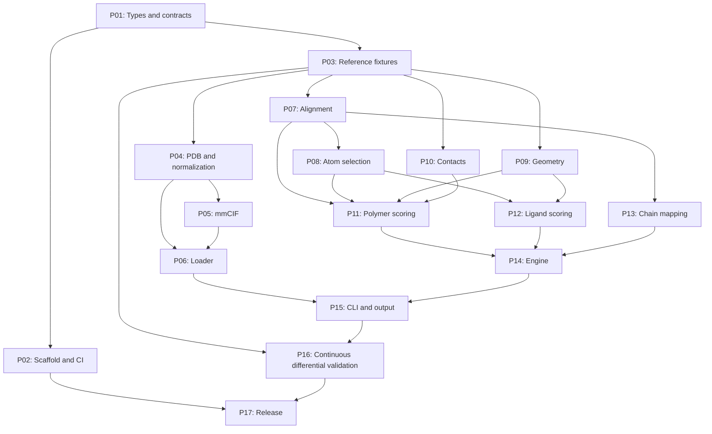

# Rust migration: work packages and parallel delivery

Status: proposed implementation plan, based on inspection of this checkout.
No Rust implementation or dependency selection is included in this document.

The implementation subsequently produced from this plan is tracked in
[rust/MIGRATION_STATUS.md](rust/MIGRATION_STATUS.md), including validation results
and known compatibility differences.

## Scope and estimate

The target is a Rust library and standalone CLI covering the current executable:
PDB/mmCIF/gzip inputs, proteins and nucleic acids, sequence and residue-number
alignment, explicit and automatic chain mapping, peptide mode, small molecules,
parallel execution, and text/JSON results. Existing Python code remains the
reference during migration. Python API compatibility is a separate optional
package because callers currently exchange Biopython objects.

The repository contains approximately 1,900 lines of Python/Cython. Its size
understates the work: Biopython supplies parsing, structure objects, alignment,
and superposition; NetworkX supplies graph isomorphism. The difficult work is
reproducing their observable behavior and validating scientific results.

The 17 required packages below total **54–91 developer-days**, before contingency.
Allow **15–25% contingency**, giving approximately **62–114 developer-days**.
These are planning ranges for developers experienced in Rust, with access to a
domain reviewer. They include package-level tests and review, but exclude learning
Rust, new scientific methods, and support for an unlimited range of malformed files.

This is a more conservative decomposition than the initial 6–10 week solo estimate:
it explicitly budgets characterization, independent ownership boundaries, integration,
and release validation. The first milestone should be used to revise the ranges.

With four full-time developers, plan roughly **6–9 calendar weeks**, provided the
contracts are settled early and the hardest packages proceed together. With one
developer, the contingency-inclusive effort is roughly **12–23 working weeks**.
Adding people beyond four or five is unlikely to shorten the initial critical path
much. These are estimates, not measured implementation rates.

## Rules that make independent ownership practical

1. Freeze a small shared contract first (P01). Each package consumes those types
   and owns its own module. Developers can use synthetic fixtures before real
   upstream implementations arrive.
2. Keep the dependency direction one-way: types → algorithms → scoring → engine
   → CLI. Parsers return types; algorithms never depend on parsers or CLI types.
3. Use one Rust crate with private modules initially, plus a library and binary
   target. Avoid a crate per developer. P02 owns the build manifest and lockfile;
   other developers request dependency changes through that owner.
4. Each package supplies an implementation, public API documentation, focused
   behavioral tests, and a short list of known compatibility differences.
5. P01 owns shared types, P02 owns build configuration, P03 owns reference fixtures,
   and P16 owns integration changes. Other owners propose changes to these shared
   areas instead of editing them independently.
6. Land small branches behind stable interfaces. Integration happens throughout
   the project; P16 has an explicit final acceptance gate as well.
7. Preserve immutable input structures. Caches and parallel work must not mutate
   structures or make results depend on scheduling.
8. Preserve the baseline's scientific behavior initially. Suspected bugs are
   recorded with reproductions and resolved explicitly; silently fixing them
   during translation would make numerical comparisons ambiguous.

## Shared contracts to settle in P01

These are proposed contract shapes, not final Rust signatures:

| Contract | Required meaning |
|---|---|
| `Structure`, `Chain`, `Residue`, `Atom` | Owned, immutable data with stable indices and preserved input order; algorithms use indices rather than Biopython-like mutable objects. |
| Identity | Chain identifiers are strings; residue identity records number, insertion code, and hetero status. Preserve author/label identifiers needed for mmCIF selection. Model selection uses a documented index convention. |
| Coordinates | Document units, stored precision, accumulation precision, and conversion points. Baseline coordinates/distances use float32 in important paths; using float64 everywhere can change contact decisions. |
| Normalization | One policy for hydrogen filtering, alternate locations, duplicate atom identifiers, modified residues, sequence symbols, and polymer/hetero classification. Both parsers obey it. |
| `LoadOptions` | Selected chains, model index, hetero inclusion, and author/label chain policy. Loading must define how PDB-to-mmCIF fallback is represented. |
| `Alignment` | Ordered columns with optional model/native residue indices and match classification; also expose the matched residue pairs and mismatch count. No formatted alignment strings between algorithms. |
| `AtomPairs` | Explicitly ordered model/native coordinate pairs and provenance indices. Missing atoms are handled consistently. |
| `RigidTransform` | One named source-to-target convention, with rotation, translation, application, and RMSD operations. |
| `SquaredDistances` | Row-major matrix with explicit dimensions; values are squared distances in Ų. No implicit threshold squaring across module boundaries. |
| `ChainMapping` | Ordered native-to-model index pairs internally. CLI syntax remains model:native. Never use unordered-map iteration to establish scientific ordering. |
| `MappingConstraints` | Fixed pairs, selected chains, wildcard semantics, and candidate ordering. Legacy string syntax belongs to the CLI adapter. |
| `ScoringOptions` | Standard/peptide mode and explicit numerical constants. Ligand scoring has a distinct result variant. |
| Results | Separate no-native-interface outcome from computation failure; structured contact counts, RMSDs, scores, mapping, and aggregate results. Small-molecule results need not invent unavailable protein metrics. |
| Failures | Typed errors and structured diagnostics; library code never exits the process or prints. CLI translates them to output and exit status. |
| Execution | Ordered candidate stream and deterministic reduction: equal best scores retain the first candidate, matching the sequential baseline rule. |

Do not freeze every internal helper in advance. Freeze the small input/output
boundaries, example values, and error semantics, then allow internal implementation
choices within each package.

## Package index

Difficulty: 1 = routine adapter; 2 = straightforward implementation; 3 = substantial
logic; 4 = specialist behavior or numerical work; 5 = high compatibility uncertainty.
Days are total developer effort per package, not elapsed time. “Needs” identifies
upstream contracts or implementations needed for acceptance; coding against agreed
interfaces and test doubles can start earlier.

| ID | Package / owned module | Difficulty | Days | Needs |
|---|---|---:|---:|---|
| P01 | Shared model and behavioral contracts — `types`, `error` | 4 | 2–3 | — |
| P02 | Rust scaffold and CI — manifest, library/binary wiring | 2 | 2–4 | P01 |
| P03 | Python reference harness and characterization fixtures — `compat/` | 4 | 3–5 | P01 contract review |
| P04 | PDB parser and normalization policy — `io/pdb`, `io/normalize` | 4 | 3–5 | P01, P03 |
| P05 | mmCIF parser — `io/mmcif` | 5 | 5–8 | P01, P03, P04 normalization contract |
| P06 | File loading and compression — `io/load` | 2 | 3–5 | P01, P04, P05 |
| P07 | Sequence and numbering alignment — `alignment` | 5 | 4–7 | P01, P03 |
| P08 | Atom correspondence and interface selection — `selection` | 3 | 2–4 | P01, P07 |
| P09 | Rigid superposition and RMSD — `geometry` | 4 | 3–5 | P01, P03 |
| P10 | Residue distances and contact counts — `contacts` | 3 | 3–5 | P01, P03 |
| P11 | Protein/nucleic acid/peptide scoring — `scoring/polymer` | 4 | 4–6 | P07–P10 |
| P12 | Small-molecule symmetry scoring — `scoring/ligand` | 5 | 4–7 | P08, P09, P03 |
| P13 | Chain compatibility and mapping enumeration — `mapping` | 4 | 4–6 | P01, P07 |
| P14 | Interface engine, scheduling, caching — `engine` | 4 | 3–5 | P11–P13 |
| P15 | CLI and output compatibility — `cli`, `output` | 3 | 3–5 | P01, P06, P14 |
| P16 | Differential integration and performance acceptance — `tests/`, `benches/` | 5 | 4–7 | P03; final acceptance needs P04–P15 |
| P17 | Release packaging and migration guide — release workflows, docs | 2 | 2–4 | P02, P15, P16 |

### P01 — Shared model and behavioral contracts

Source: all modules, especially `parsers.py`, `align_chains`, `subset_atoms`, and
`run_on_all_native_interfaces` in `DockQ.py`.

Deliver the types above, module ownership map, a small in-memory structure fixture,
and examples of every cross-module boundary. Record the baseline revision and
behavioral decisions with unresolved questions assigned to an owner.

Acceptance: parser, alignment, geometry, mapping, and scoring owners can implement
against the same synthetic structure without introducing their own structure types.
Explicitly agree coordinate precision, mapping direction, ordering, transform
direction, and no-interface/error semantics. This package needs an integration lead
with a domain reviewer; it should not become an open-ended framework design task.

### P02 — Rust scaffold and CI

Deliver an isolated Rust project location (proposed `rust/`), library and executable
targets, formatting/lint/test jobs, and a supported-platform/build policy. Keep
Python installation and existing checks usable during development. Assess and pin
dependencies when implementation starts; this plan does not assume any particular
current Rust parser or numerical library is suitable.

Acceptance: a clean checkout builds and tests the skeleton; CI runs Rust checks
alongside existing Python regression checks. The owner maintains manifest and
lockfile edits requested by other packages.

### P03 — Python reference harness and characterization fixtures

Source: `run_test.sh`, `examples/`, `testdata/`, and importable functions in
`DockQ.py`. Existing text snapshots mostly round metrics, and the ligand test only
checks successful execution; they are insufficient as the sole migration oracle.

Pin and record Python/dependency versions and whether compiled Cython is active.
Export parsed structures, alignments, matched atoms, transforms, squared distances,
contact counts, per-interface metrics, and selected mappings through a versioned
fixture format. Include synthetic boundary cases and all supplied examples. Python
is required to regenerate fixtures, not to run the released Rust executable.

Acceptance: reproducible fixture generation and an initial compatibility ledger.
Exercise Cython and fallback separately and flag disagreements instead of assuming
they define one identical reference. Prioritize fixtures that unblock P04/P07/P09/
P10 before expanding the corpus. Supply initial field-specific tolerance proposals.

### P04 — PDB parsing and normalization

Source: `PDBParser` in `parsers.py`; residue mappings in that file and
`BACKBONE_ATOMS` in `constants.py`.

Implement PDB records needed for scoring, chain/model selection, residue sequence,
hetero handling, atom elements, alternate-location choice, and modified residues.
Own shared normalization helpers and publish their contract before P05 starts
format-specific work. P05 consumes those helpers rather than duplicating policy.

Acceptance: atom identities, coordinates, order, sequences, and hetero classification
match P03 fixtures. Include insertion codes, negative numbering, absent atoms,
duplicate/alternate atom records, hydrogens, and multiple models. Matching all of
Biopython's metadata and structure-writing functionality is outside scope.

### P05 — mmCIF parsing

Source: `MMCIFParser` in `parsers.py`, including author/label selection and
`_atom_site` processing.

Implement scoring-relevant mmCIF ingestion into the same types as P04. Cover token
syntax, missing values, model numbers, author/label identifiers, multi-character
chains, and non-polymers. Reuse normalization. Valid identifiers must survive even
when the legacy CLI mapping syntax cannot express them unambiguously.

Acceptance: equivalent PDB/mmCIF fixtures yield equivalent normalized structures
where expected, and ligand-mode chain identifiers match the reference. Test quoted
and multiline values and missing optional fields. Full mmCIF dictionary validation
is outside scope. Largest uncertainty: an available parser's actual behavioral fit.

### P06 — Loading and compression

Source: `load_PDB` in `DockQ.py`.

Own file opening, gzip decoding, parser dispatch/fallback, path context in errors,
and load-option routing. P04/P05 receive readers or text rather than opening paths.
Implement initially against parser test doubles; this package does not need to wait
idle for both parsers.

Acceptance: plain/compressed examples load equivalently; corrupt gzip, missing
files, invalid structures, and model-selection failures produce useful errors.
Document any deliberate difference from Python's broad exception-based fallback.

### P07 — Sequence and residue-number alignment

Source: `align_chains`, `format_alignment`, `get_aligned_residues`.

Implement affine-gap alignment with the current scores (match 5, mismatch 0,
gap open −4, extension −0.5), residue-number mode, mismatch counts, and ordered
matched residue pairs. Reproduce which alignment is chosen when several have
the same score. Numbering mode currently aligns encoded integer numbers; do not
quietly change it into a direct full-residue-ID join.

Acceptance: full alignment columns and selected residue pairs match fixtures for
gaps, repeats, mismatches, negative numbering, terminal gaps, and ambiguous optima.
Insertion-code behavior must be characterized, not inferred from the parser model.
This package is on the critical path and needs an owner comfortable with dynamic
programming and compatibility debugging.

### P08 — Atom correspondence and interface selection

Source: `subset_atoms`, `list_atoms_per_residue`, `get_interacting_pairs`, and
coordinate selection in `calc_DockQ`/`calc_sym_corrected_lrmsd`.

Deliver atom-pair extraction with consistent ordering, backbone selection for
proteins/nucleic acids, missing-atom handling, interface residue selection, and
peptide CB/CA selection. Preserve the distinction between all-atom contacts and
backbone RMSD atoms. Work against manually supplied alignments first.

Acceptance: exact atom identity/order correspondence and selected residue sets
match fixtures, including duplicate interface residue indices and empty selections.
Do not place parser normalization or sequence alignment implementations here.

### P09 — Rigid geometry

Source: `SVDSuperimposer` usage in both scoring paths.

Deliver best-fit proper rotation/translation, fitted RMSD, transform application,
and RMSD without refitting. Explicitly define row/column and source/target
conventions so ligand scoring cannot accidentally reverse the transform.

Acceptance: known translations/rotations, reflection handling, random point sets,
and baseline receptor/ligand fixtures pass agreed tolerances. Define behavior for
empty, collinear, coplanar, and very small point sets. Degenerate cases may have
non-unique transforms; assess downstream behavior as well as fitted RMSD.

### P10 — Distance and contact kernel

Source: `operations.pyx`, `operations_nocy.py`, and distance construction in
`get_residue_distances`.

Deliver squared inter-residue distances from grouped atoms, contact statistics,
and clash counting. Make precision and strict `< threshold²` comparisons explicit.
Start with a clear scalar implementation; optimization follows measured needs.

Acceptance: dimensions and integer counts match fixtures; test exact threshold
boundaries, unusual atom group sizes, and representative large interfaces. Review
the Cython early-break condition (`min_d > 1000.0`) as a potential behavior
difference from exhaustive minimum distances. Record a reproduction before deciding
whether to emulate or correct it; this is not an assumed confirmed defect.

### P11 — Polymer and peptide scoring

Source: `calc_DockQ`, `dockq_formula`, `f1`, and constants.

Compose alignment, selection, geometry, and contacts into per-interface results.
Preserve native-contact totals computed on the original native structure, the
alignment-dependent comparisons, receptor/ligand assignment, and peptide thresholds.
Include nucleic-acid backbone behavior in this package's acceptance, not as an
unowned future extension.

Acceptance: standard, peptide, unequal-length, equal-length, missing-residue,
no-contact, and nucleic-acid cases match fixtures. Preserve equal-length ordering
because it can change LRMSD. All reported counts and intermediate metrics are
checked, not just the final DockQ value. Formula helpers stay local to this owner.

### P12 — Ligand symmetry scoring

Source: `calc_sym_corrected_lrmsd`, `create_graph`, covalent radii and bond tolerance.

Own ligand graph construction, isomorphism enumeration, receptor-interface fitting,
minimum transformed ligand RMSD, ligand atom mapping, and ligand-specific score.
This package has a different result shape and selection path from polymer scoring.
Use P08/P09 interfaces rather than copying geometry and atom selection logic.

Acceptance: supplied ligand example plus synthetic symmetric/asymmetric molecules,
different atom orders, incompatible graphs, and multiple equal optima. Characterize
the reference's graph matching semantics: do not add element-label restrictions or
chemical constraints merely because they seem more natural. Define no-isomorphism
behavior and any deliberate improvement in the compatibility ledger. Measure
enumeration growth on representative symmetric ligands.

### P13 — Chain compatibility and enumeration

Source: `group_chains`, `product_without_dupl`, `count_chain_combinations`,
`get_all_chain_maps`, and the semantic rules in `format_mapping`.

Consume normalized constraints and alignment results. Deliver compatible-chain
groups, injective ordered candidate mappings, fixed/wildcard restrictions, reverse
mapping for unequal chain counts, and combination counting. CLI string parsing
belongs to P15; semantic validation belongs here. Expose candidates as a lazy stream.

Acceptance: exact candidate membership and order match small enumerable fixtures;
counts are verified against enumeration on small cases and avoid integer overflow
on large cases. Cover fixed/partial mapping, subset selection, mismatches, hetero
compatibility, unequal chain counts, and impossible assignments. Optimization must
not silently alter ordering or tie behavior.

### P14 — Evaluation engine and parallel execution

Source: `run_on_chains`, `run_on_all_native_interfaces`, and search/reduction in
`main`, including low-memory behavior.

Deliver a serial reference engine first: evaluate chain-pair interfaces, route to
the appropriate scorer, aggregate candidates, select the best mapping, and produce
the final result. Then add worker scheduling, bounded in-flight work, cache policy,
and low-memory evaluation/recomputation. Core scoring functions remain independently
callable and unaware of thread pools.

Acceptance: serial and parallel execution select identical mappings/results across
worker counts, including score ties. Candidate order remains deterministic and
memory use stays bounded during large searches. Preserve sum-versus-average
selection/normalization semantics from the baseline; do not infer them from README
wording. `n_cpu` and `max_chunk` compatibility is agreed with P15.

### P15 — CLI and output

Source: `parse_args`, `format_mapping`, `format_mapping_string`, `print_results`,
`print_header`, and final JSON construction in `main`.

Own argument parsing, legacy mapping-string adapter, help, output formatting,
JSON field compatibility, progress/diagnostics routing, and exit codes. Consume
engine results; never duplicate scoring or mapping search. Build against synthetic
results while the engine is under development.

Acceptance: existing shell regression cases are reproducible, JSON retains agreed
keys/types, and errors/flags have documented behavior. Preserve displayed
model:native versus internal native-to-model direction. Characterize how existing
mapping syntax handles multi-character mmCIF identifiers; richer syntax is a
separate product decision, not a hidden change in this migration.

### P16 — Differential integration and performance acceptance

Own cross-package acceptance tests and the compatibility ledger, in collaboration
with the domain reviewer. Start as soon as P03 produces fixtures. Reserve part of
the effort for final integration instead of spending it all on early scaffolding.

Acceptance gates:

- Structural identities, selected atom/residue pairs, contact counts, and ordered
  candidate mappings match exactly where the contract requires it.
- Floating metrics use field-specific absolute/relative tolerances calibrated
  against the baseline. Threshold and score-tie cases receive explicit review;
  tolerances cannot conceal a different contact count or mapping selection.
- Every example and synthetic edge case runs end to end. Cover peptide, nucleic
  acid, compressed mmCIF, ligands, no interfaces, missing atoms, alternate locations,
  and large mapping searches. Add representative user structures when available.
- Compare wall time and peak memory with the pinned Python/Cython baseline on
  fixed hardware and worker counts. Agree performance targets after measurement;
  a language rewrite alone does not establish an expected speedup.
- Accepted differences have a reproduction, rationale, and visible documentation.

P16 diagnoses which boundary first diverges. The relevant module owner fixes its
implementation; this package is not a substitute owner for every algorithm.

### P17 — Release and handover

Deliver supported-platform binaries, version/help information, installation and
migration instructions, release checks, licensing/attribution review for reused
material and dependencies, and a reproducible documented build.

Acceptance: release artifacts run on clean supported systems without Python;
document feature coverage, known differences, and how to verify a release. Preserve
project attribution and scientific citation guidance. Publishing a release is a
separate action from preparing and validating its artifacts.

## Optional follow-up packages

| ID | Package | Difficulty | Days | Boundary |
|---|---|---:|---:|---|
| O01 | Python bindings and wheels | 4 | 5–10 | Depends on stable library API. Owns Python packaging and conversions; preserving existing Biopython object inputs needs an explicit compatibility design. |
| O02 | Profile-driven optimization | 4 | 3–10 | Begins after P16 profiling; proposed changes belong with the affected module owner. No speculative speedup is assumed. |
| O03 | Extended real-world structure corpus | 3 | 3–7 | Additional source selection, expected-result review, and unusual-file handling beyond the initial agreed corpus. |

Do not include these in the required estimate unless they are selected. P03/P16
already include the validation necessary for the required scope; O03 extends it.

## Dependency graph and delivery gates

The P04 → P05 edge requires agreement on normalization, not completion of all PDB
work. The same distinction applies elsewhere: dependencies gate acceptance;
contracts and fixtures permit earlier parallel implementation.

**Gate A — contracts and reference ready:** P01, initial P02/P03; demonstrate a
synthetic structure flowing through stubbed boundaries. Aim for the first 3–5
working days with multiple contributors. Re-estimate after discovering baseline
ambiguities and dependency fit.

**Gate B — explicit-mapping polymer slice:** P04 and P06's PDB path, P07–P11,
minimal P14/P15, and differential validation. Load one real pair, apply an explicit
mapping, and reproduce counts and unrounded metrics. This is the first meaningful
end-to-end proof; automatic search and ligands need not block it.

**Gate C — complete feature integration:** mmCIF/gzip, automatic mapping, peptide
and nucleic-acid coverage, ligand scoring, and deterministic parallel execution.

**Gate D — release candidate:** all P16 acceptance gates, documented differences,
and clean-system release checks from P17.

The likely critical paths are alignment → selection/scoring → engine → integration,
and parser normalization → mmCIF → end-to-end validation. Ligand symmetry can
become a third critical path if matching-library behavior differs substantially.

## Example allocation for four developers

These are balanced ownership lanes, not four branches that merge only at the end.
Owners work through the gate dependencies and review adjacent interfaces together.

| Developer | Primary packages | Approximate base effort |
|---|---|---:|
| A: integration/compatibility lead | P01, P03, P06, P16 | 12–20 days |
| B: structural input/release | P02, P04, P05, P17 | 12–21 days |
| C: correspondence/search | P07, P08, P13, P15 | 13–22 days |
| D: numerical/scoring | P09, P10, P11, P12, P14 | 17–28 days |

Lane D is the bottleneck. Once P03's initial fixtures are ready, A should take P10
(3–5 days) while continuing reference/integration ownership; D then owns 14–23
days and A 15–25. B can prepare P06 loading adapters while awaiting parser review,
but A retains ownership. C can build output against synthetic results early.
All developers need time for reviews and integration fixes; contingency covers
discovery work rather than assuming every available hour is feature coding.

With five developers, give geometry/contact kernels (P09/P10) to a separate
numerical owner and keep P11/P12/P14 together. Further splitting the small scoring
functions, constants tables, or individual CLI flags would add coordination without
creating useful independent work.

## First assignment batch

1. Assign a contract/integration owner and a scientific reviewer. Settle P01 with
   short examples and a compatibility ledger.
2. Start P02 and the first P03 fixtures immediately, using the existing checkout as
   the recorded baseline. Characterize compiled-versus-fallback discrepancies.
3. After contract review, issue P04/P05, P07, P09, and P10 as independent work;
   P05 starts with the shared normalization contract, not a second normalization design.
4. Build the Gate B explicit-mapping slice before expanding engine optimization or
   release scope. Use the measured results to update schedule and risk estimates.

The next concrete planning artifact should be issue-sized assignments derived from
these packages after P01: each issue includes its exact signatures, fixture inputs,
owned paths, acceptance checks, and reviewer. This document supplies the ownership
and dependency frame; it intentionally leaves implementation choices reviewable.
